BACKEND &nbsp; / &nbsp; APIs REST &nbsp; / &nbsp; SOFTWARE PARA NEGOCIOS REALES

# Jhon Alex Rosero Gallego

### De la obra al código.

Aprendiz SENA del Tecnólogo en Análisis y Desarrollo de Software · **Etapa productiva desde abril de 2027**

[Cliente real](#cliente-real) &nbsp; · &nbsp; [Proyecto SENA](#proyecto-sena) &nbsp; · &nbsp; [Más proyectos](#mas-proyectos) &nbsp; · &nbsp; [De la obra al software](#obra-software) &nbsp; · &nbsp; [Tecnologías](#tecnologias)

---

  

### Sobre mí

Durante 10 años trabajé en construcción y, como contratista, tuve a cargo obras de infraestructura:

- **Obra vial** con alcantarillas y placa huella: **3 frentes de trabajo a la vez y entre 25 y 30 trabajadores** a cargo.
- Construcción de un **colegio**.
- Construcción de un **box culvert**.

Dirigí equipos, coordiné frentes en paralelo, respondí ante los ingenieros y me quedé hasta que cada obra estuvo terminada. Hoy llevo esa forma de trabajar al software.

Me enfoco en el **backend**: modelo los datos, diseño APIs REST, escribo las reglas del negocio y las respaldo con **pruebas automatizadas**. También trabajo con React y TypeScript en el frontend y con Kotlin en Android.

Busco mi **etapa productiva (contrato de aprendizaje) desde abril de 2027** en un equipo de desarrollo donde pueda aportar en backend y seguir creciendo.

## 01 / Cliente real

<table>
<tr><td>

COMERCIO · APP DE ESCRITORIO PARA WINDOWS · VERSIÓN INICIAL CON EL CLIENTE

### Punto Moto

**Una tienda de repuestos y un taller de motos, manejados desde un solo programa.**

Sistema para que el dueño controle inventario, ventas, caja y el trabajo de sus mecánicos sin depender de cuadernos ni hojas de cálculo. Se instala en Windows y guarda los datos en el equipo del negocio.

**Mi rol:** desarrollé el backend en Django REST Framework, de la versión 0.2.0 a la 0.11.0.

**Vender** → Ventas, caja, pagos y devoluciones.  
**Controlar** → Inventario con kárdex, ajustes e inventario inicial.  
**Comprar** → Proveedores, recepción de mercancía, abonos y alza automática de precios.  
**Liquidar** → Servicios de taller, porcentaje de cada mecánico y descuentos por mal servicio.

[**Ver Punto Moto →**](https://github.com/Jcabr3ra1/Punto_Motos)

<strong>Qué construí exactamente</strong>

| Versión | Módulo del backend |
|---|---|
| 0.2.0 | Usuarios, roles, sesión por token y permisos |
| 0.3.0 | Catálogo de productos con códigos internos y buscador |
| 0.4.0 | Inventario: existencias, kárdex, ajustes e inventario inicial |
| 0.5.0 | Compras a proveedores con abonos y alza automática de precios |
| 0.6.0 | Ventas, caja y consignaciones |
| 0.7.0 | Servicios de taller y mecánicos |
| 0.8.0 | Liquidación diaria de mecánicos |
| 0.9.0 | Devoluciones y descuentos por mal servicio |
| 0.10.0 | Eliminar productos sin historial y bloquear duplicados |
| 0.11.0 | Ventas sin cliente obligatorio |

Cada módulo trae sus **pruebas automatizadas** (modelos, serializers y vistas con `APITestCase`), su documentación en el contrato de la API y su entrada en el registro de cambios.

</td></tr>
</table>

## 02 / Proyecto formativo SENA

<table>
<tr><td>

AGROTECH · APLICACIÓN WEB + IoT · TRABAJO EN EQUIPO

### AVISENS

**Gestión avícola para granjas de pollo de engorde.**

Plataforma para registrar la operación diaria de una granja, vigilar el ambiente de los galpones y comparar cada lote con lo esperado.

**Mi rol:** desarrollé en NestJS los módulos de **alertas** y **canales de alerta** (controlador, servicio, DTO y pruebas con Jest), y corregí hallazgos del informe de QA en backend y frontend.

[**Ver AVISENS →**](https://github.com/Jcabr3ra1/Avisens-Project)

</td></tr>
</table>

## 03 / Más proyectos

<strong>Ambiente y Clima</strong>: monitoreo ambiental en equipo

API en Django REST con zonas, mediciones, alertas y recomendaciones; validaciones de fecha y de rango, filtros y documentación Swagger. Trabajo en pareja con Git Flow, ramas por funcionalidad y pull requests. Llevo una bitácora de cómo uso la IA: para aprender y revisar, y el código lo escribo yo.

[**Ver repositorio →**](https://github.com/Alex959R/ambiente-clima)

<strong>API de Empleados de Obra</strong>: mi experiencia en construcción, en una API

CRUD de personal de obra por rango (ayudante, oficial, maestro, inspector, ingeniero), usuarios con modelo personalizado, inicio de sesión por token y Swagger.

[**Ver repositorio →**](https://github.com/Alex959R/ejercicioDjangoApis)

<strong>Control Forte</strong>: sitio web para una empresa de control de plagas

Landing page en React para un cliente real, con servicios, galería de trabajos y botón de WhatsApp para recibir clientes.

[**Ver repositorio →**](https://github.com/Alex959R/control-forte)

<strong>Dashboard de Ventas</strong>: panel con roles, KPI y gráficos

React + TypeScript con autenticación por roles, CRUD de productos y gráficos con Recharts.

[**Ver repositorio →**](https://github.com/Alex959R/dashboard-ventas)

<strong>Finca Ganadera</strong>: app Android de rentabilidad lechera

Kotlin nativo: calcula producción, ingresos, gastos y utilidad diaria, con la lógica separada de la interfaz.

[**Ver repositorio →**](https://github.com/Alex959R/Finca-Ganadera)

## 04 / De la obra al software

Lo que aprendí dirigiendo obras es lo mismo que necesita un equipo de desarrollo:

| En la obra | En el software |
|---|---|
| Leer planos antes de levantar un muro | Entender los requisitos y modelar los datos antes de programar |
| Cimientos firmes | Un backend con reglas claras y validaciones |
| Revisar cada etapa antes de seguir | Pruebas automatizadas en cada módulo |
| Cumplir el cronograma con el cliente | Entregar por versiones y documentar los cambios |
| Coordinar una cuadrilla con respeto y autoridad | Trabajar en equipo con ramas, pull requests y revisiones |
| Llevar 3 frentes de obra al mismo tiempo | Avanzar en varios módulos sin perder el orden ni la calidad |
| Salir de último cuando todo está terminado | Hacerme cargo del resultado hasta que funcione |

## 05 / Mi caja de herramientas

**Backend**

**Frontend y móvil**

**Herramientas**

Django REST Framework · Swagger · pruebas con `APITestCase` y Jest · Git Flow · commits convencionales

## 06 / Construyendo todos los días

  <picture>
    <source media="(prefers-color-scheme: dark)" srcset="https://raw.githubusercontent.com/Alex959R/Alex959R/output/github-snake-dark.svg" />
    
  </picture>

---

**¿Buscan un aprendiz que termine lo que empieza?**

Jhon Alex Rosero Gallego · Backend · Popayán, Cauca

